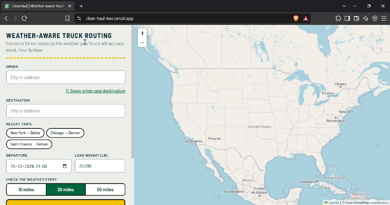
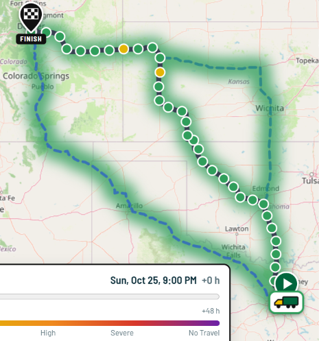
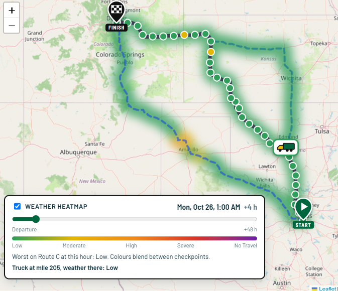
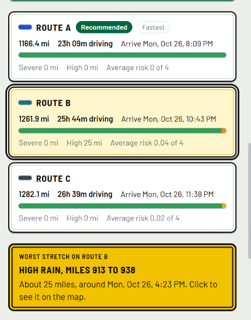

# ClearHaul

Weather-aware truck routing. Enter where you are going, when you leave and how heavy your load is. ClearHaul finds three routes, checks the weather the truck will actually meet at each checkpoint (at the truck's own arrival time there), and recommends the safest one.

- **Live app:** https://clear-haul-two.vercel.app/
- **API health check:** https://clearhaul-8di8.onrender.com/api/health
- **Walkthrough videos:** <!-- `<main Loom link>`--> Soon... (short overview, with the backend and frontend deep dives linked in its description)

> The backend runs on a free hosting tier. If nobody used it for a while, the first request can take up to 30 seconds while the server wakes up. A free monitor pings it every 5 minutes, and the page wakes it as soon as it opens, so this should rarely happen.

## What it does



| Route comparison                                         | Heatmap and truck                                 | Worst stretch                                 |
| -------------------------------------------------------- | ------------------------------------------------- | --------------------------------------------- |
|  |  |  |

1. You enter an origin, a destination, a departure time, a load weight, and how often to sample the weather (every 10, 25 or 50 miles).
2. The backend gets up to three different routes from OSRM.
3. For each route it places checkpoints along the road and works out when the truck will reach each one.
4. It looks up the hourly forecast for each checkpoint at that arrival time and classifies the risk from wind, rain and snow, including the load rules.
5. It ranks the routes and explains the recommendation in one sentence.
6. The map shows all routes, the checkpoints of the selected route, start and finish pins, and a weather heatmap along the corridor with a 0 to 48 hour slider.
7. As you move the slider, a truck drives along the selected route to where it will be at that hour. Its outline shows the risk level it meets there.
8. Above the checkpoint table, a sign points out the worst stretch of the selected route: the risk level, the miles, the time and the cause (for example "Severe wind, miles 480 to 560"). Click it and the map flies there.

Smaller things that make it easier to use:

- **Recent trips:** the last 4 successful trips appear as chips under the form. One click fills in origin and destination.
- **Swap button:** flips origin and destination.
- **No stale results:** every new search clears the previous trip first, so an error (for example a place with no road connection) never leaves old routes on screen.
- **Plain explanations:** every checkpoint says which condition caused its risk level (for example "wind, rain"), and the load rule is shown when the load made it worse.
- **Colour plus text:** risk is always written out as well as coloured.

The interface uses a highway sign look: the recommendation is a green guide sign, route options are white regulatory signs, the main action is a yellow warning-style button, and the worst stretch is a yellow warning sign (red for Severe and No Travel). Risk colours are kept the same everywhere so the map legend always matches.

## How the risk is calculated

Thresholds come straight from the brief.

| Condition    | Low        | Moderate     | High         | Severe       | No Travel  |
| ------------ | ---------- | ------------ | ------------ | ------------ | ---------- |
| Wind (mph)   | under 25   | 25 to 34     | 35 to 44     | 45 to 54     | 55 or more |
| Rain (in/hr) | under 0.10 | 0.10 to 0.25 | 0.25 to 0.50 | 0.50 to 1.00 | over 1.00  |
| Snow (in/hr) | under 0.5  | 0.5 to 1.0   | 1.0 to 2.0   | 2.0 to 3.0   | over 3.0   |

Load rules:

- Wind of 55 mph or more is No Travel for any load.
- Wind of 45 to 54 mph with a load over 30,000 lb is No Travel.
- Wind of 35 to 44 mph with a load over 40,000 lb is Severe.

The level at a checkpoint is the worst of wind, rain and snow, after the load rules. The checkpoint also records every condition that reached that level, so the UI can say "Driven by wind, rain".

**Boundary choices.** The brief's ranges touch each other (for example rain "0.10 to 0.25" then "0.25 to 0.50"). I treat the lower bound as inclusive, so 0.25 in/hr is High. No Travel follows the brief literally: wind at 55 is No Travel, but rain of exactly 1.00 and snow of exactly 3.0 stay Severe.

## How the best route is chosen

Routes are compared in this order, and the first difference decides:

1. Fewest No Travel miles (a route you are not allowed to drive can never beat one you can)
2. Fewest Severe miles
3. Fewest High miles
4. Lowest average risk
5. Shortest travel time

Putting No Travel first is an addition to the brief's list. Without it a route with a No Travel stretch could win just because it had fewer Severe miles.

**Miles, not checkpoint counts.** Each checkpoint speaks for the stretch of road halfway to its neighbours on both sides. "Severe miles" is the sum of those stretches, so the result does not change just because you sample every 10 miles instead of every 50.

## Design decisions worth knowing

- **Pure logic is separate.** Everything in `domain/` is plain Python with no Django and no HTTP, so every rule is unit tested without a network.
- **ETAs follow the road.** OSRM returns a duration for each small segment, so city stretches take longer than highway stretches. OSRM only knows car speeds, so the total trip time is scaled by 1.10 for a truck (`TRUCK_TIME_FACTOR`).
- **One weather request for the whole trip.** All checkpoints of all routes are sent to Open-Meteo in batches of 40 places, four batches in parallel. Places are rounded to 2 decimals (about 1 km) so nearby points share one forecast, and results are cached for 15 minutes.
- **The slider never calls the API.** The first response already contains the risk level for 49 hours at every checkpoint. Moving the slider only recolours the route slices whose colour changed, and moves the truck. Colours blend between checkpoints.
- **The truck position is calculated, not animated by the server.** The frontend interpolates between the checkpoint arrival times to find the mile the truck is at, then finds that point on the route line.
- **The worst stretch is worked out in the browser** from data the backend already sends (risk level, mile, arrival time and cause of each checkpoint). It takes the longest run of neighbouring checkpoints at the route's highest level, and measures it with the same "halfway to the neighbours" miles as the backend, so it agrees with the Severe and High miles on the route cards.
- **Three routes, even when OSRM returns one.** If OSRM returns fewer than three, the backend asks for routes through points pushed sideways from the midpoint, and keeps only the ones that are really different.
- **Failures are explained.** Upstream problems (place not found, no road between the places, weather service down) come back as a readable error message instead of a crash. Temporary errors are retried.
- **Recent trips stay in your browser.** They are saved in `localStorage` only after a successful search, using the coordinates the backend resolved. Nothing is sent to a server.

## Project structure

```
backend/
  manage.py
  config/                Django settings and root URLs
  routing/
    api/                 serializers, views, urls
    domain/              pure logic: types, risk, geometry, checkpoints, recommend
    clients/             http (retries), cache, geocode, routing (OSRM), weather (Open-Meteo)
    services/            trip_planner.py ties everything together
    tests/
frontend/
  public/                logo and favicon
  src/
    components/          MapView, MapPanel, HeatControls, TripForm, PlaceInput, RouteList, WorstStretch, CheckpointTable
    api.js               calls the backend
    history.js           recent trips (localStorage)
    utils.js             colours, route slicing, truck position, worst stretch
    App.jsx
```

## API

`GET /api/health` returns `{"status": "ok"}`.

`GET /api/geocode?q=Dallas` returns `{"results": [{"label", "lat", "lng"}]}` for the place search box.

`POST /api/analyze` analyses one trip.

```json
{
  "origin": "Dallas, TX",
  "destination": { "lat": 39.74, "lng": -104.99, "label": "Denver, CO" },
  "departure": "2026-10-26T14:00:00Z",
  "load_weight_lb": 35000,
  "interval_miles": 25
}
```

A place can be text or a picked suggestion. The departure must be within the next 14 days (forecasts do not reach further), the load between 0 and 100,000 lb, and the interval 10, 25 or 50.

The response contains `recommended_route_id`, a `recommendation` with the reason, and `routes`. Each route has its distance, duration, arrival time, line to draw, a `summary` (miles per risk level, average risk) and its `checkpoints` (ETA, weather, risk level, causes, and `heat`, the risk level for each of the 49 slider hours).

## Run it locally

You need Python 3.12 or newer and Node 20 or newer.

```bash
# backend
cd backend
python -m venv venv
source venv/bin/activate        # Windows: venv\Scripts\activate
pip install -r requirements.txt
python manage.py runserver      # http://127.0.0.1:8000

# frontend (second terminal)
cd frontend
npm install
npm run dev                     # Vite proxies /api to port 8000
```

Tests:

```bash
cd backend && python -m pytest -q
cd frontend && npm test
```

## Deployment

The backend runs on Render (free web service) and the frontend on Vercel.

**Backend (Render):** root directory `backend`, build command `pip install -r requirements.txt`, start command `gunicorn config.wsgi --workers 1 --threads 4 --timeout 120`. One worker keeps the weather cache in one place, and the longer timeout is needed because a trip analysis can take 10 to 30 seconds.

**Frontend (Vercel):** root directory `frontend`, framework preset Vite, and `VITE_API_BASE` set to the backend URL.

Backend environment variables:

| Variable               | Purpose                                                               |
| ---------------------- | --------------------------------------------------------------------- |
| `SECRET_KEY`           | Django secret key (required in production)                            |
| `DEBUG`                | `0` in production, defaults to `1`                                    |
| `ALLOWED_HOSTS`        | Extra hosts, comma separated (the Render host is added automatically) |
| `CORS_ALLOWED_ORIGINS` | Frontend URL(s), comma separated. If empty, all origins are allowed   |
| `PYTHON_VERSION`       | Python version for the Render build                                   |
| `OSRM_BASE_URL`        | Routing server, defaults to the public OSRM demo server               |
| `TRUCK_TIME_FACTOR`    | Multiplier on car travel times, default 1.10                          |

## Assumptions and limits

- **No live or predicted traffic.** Travel times come from typical road speeds, scaled for trucks. Traffic data needs a paid API with a key, and a guess would be worse than a clear limit, so I left it out.
- **Routing is a car profile scaled for trucks.** It does not know about truck height, weight or hazmat restrictions. A real product would use a truck-aware routing API.
- **Free public services.** The public OSRM server and Open-Meteo are free and rate limited, which is fine for a demo but not for production.
- **Forecast range.** Open-Meteo hourly forecasts reach about 15 days ahead. Checkpoints without a forecast are marked "No forecast" and counted as Low in the totals.
- **Wind uses sustained wind speed at 10 m.** Gusts are shown in the popup but do not change the risk level.
- **Rain is rain plus showers**, and snow is Open-Meteo's hourly snowfall, both in inches per hour.
- **The heatmap is an approximation.** It blends the risk between neighbouring checkpoints. It is not a radar image.
- **The cache lives in memory** of one server process, which is enough for this deployment.

## If this were built for real drivers

Ideas I did not build, in the order I would do them:

1. A best departure time suggestion for the next 48 hours, reusing the same forecast data.
2. Live traffic in the ETAs.
3. Hours-of-service rules (driving limits and mandatory breaks) in the ETAs.
4. Truck-aware routing with height and weight restrictions.
5. Local time at each checkpoint, and alerts when the forecast changes on a route.

## Credits

Routing by [OSRM](https://project-osrm.org), weather by [Open-Meteo](https://open-meteo.com), place search by Open-Meteo geocoding and Nominatim, map data by [OpenStreetMap](https://www.openstreetmap.org) contributors, map display by [Leaflet](https://leafletjs.com).

<!--
## About how this was built

I used Claude (Anthropic) as an AI assistant for design discussion, code review and parts of the implementation. The walkthrough videos explain how the code works.
-->
